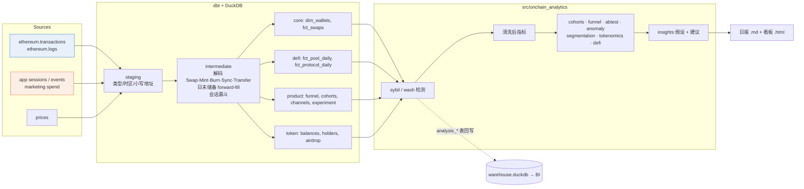

# On-chain Analytics:DEX 协议增长与健康度分析

一个端到端的 Web3 数据分析项目。从 **原始区块链日志** 出发,用 dbt 解码建模,结合 **链下产品埋点**,产出 DeFi 指标、用户增长、A/B 实验、女巫/刷量识别、代币经济分析,最后自动生成 **日报 + 交互式看板**,并给出可执行的业务建议。

配套一个 Claude Code Skill(`.claude/skills/onchain-analyst/`),可以用同一套方法研究**真实**链上数据(Dune / DefiLlama / Etherscan / RPC)。

```
python pipeline.py      # ~30 秒:生成数据 → dbt build(26 个模型 + 25 个数据测试)→ 分析 → 报告
```

产出:[`reports/output/latest_report.md`](reports/output/latest_report.md)(日报)· [`reports/output/dashboard.html`](reports/output/dashboard.html)(看板,浏览器直接打开)

---

## 为什么用模拟数据?怎么换成真实数据?

模拟器(`data_gen/generate.py`)按 **Uniswap V2 的真实合约逻辑**(恒定乘积 AMM、0.3% 手续费、套利机器人)生成一个虚构 DEX「DemoSwap」5 个月的数据,表结构与 Dune 原始表一致:

| 表 | 对应 Dune 表 | 内容 |
|---|---|---|
| `raw_transactions` | `ethereum.transactions` | 7.6 万笔交易(含失败交易) |
| `raw_logs` | `ethereum.logs` | 15.6 万条事件日志,`topic0..3` + `data` 都是十六进制原文,**需要自己解码** |
| `raw_prices_daily` | `prices.day` | 代币日价格 |
| `raw_app_sessions / events` | Segment / Amplitude 埋点 | 24 万个会话、62 万条事件:访问 → 连接钱包 → 报价 → 提交(带 `tx_hash`) |
| `raw_marketing_spend` | 投放后台 | 各渠道每日花费 |

这样做有两个原因:
1. **可离线复现,能放进 CI**:任何人 clone 下来就能跑。
2. **有真值(ground truth)可以验证方法**:模拟器埋了女巫簇、刷量、做市商撤资、团队解锁和一个 A/B 效果,分析层在**不看标签**的前提下把它们找出来,再和真值对比打分(见下方「模型验证」)。真实数据上没有标签,这一步证明了检测方法本身是可靠的。

**换成真实数据**:`dune_queries/` 里有 9 个可以直接在 Dune 上跑的 DuneSQL 查询(Uniswap 等真实协议)。也可以用 `onchain_fetch.py rpc logs` 拉取任意 V2 池子的 Swap/Sync/Mint/Burn 日志,落成同样结构的 parquet,然后运行 `python pipeline.py --skip-generate`。

---

## JD 要求 → 项目对应

| JD 要求 | 在项目中的体现 |
|---|---|
| 分析链上和链下数据:交易、钱包、代币、合约、用户行为 | 从 `ethereum.logs` 原文解码 Swap/Mint/Burn/Sync/Transfer;用 `tx_hash` 把前端埋点和链上回执连起来(`int_session_funnel`) |
| 设计仪表盘与分析报告,监控核心指标 | `reports/output/dashboard.html`:KPI、TVL、交易量构成、DAU 报告口径 vs 清洗后、同期群热力图、漏斗、实验、异常 |
| 用户行为、留存、流失、转化漏斗、获客效果 | `fct_cohort_retention_weekly`、`cohorts.monthly_churn`、`fct_funnel_daily`、`fct_channel_performance`(CAC / D30 / LTV) |
| DeFi 指标:TVL、交易量、流动性、手续费、收益率 | TVL 由 Sync 储备量 × 价格计算;Fee APR、成交/TVL(资本效率)、**LP 收益 vs 无常损失**、盈亏平衡成交量、LP 集中度 |
| 用户分群、同期群、异常识别、业务机会 | 价值分层 / 行为分群 / RFM;稳健 z 分数异常检测 + **自动归因**(哪些钱包、哪个池子);女巫与刷量识别 |
| SQL 处理大规模数据 | dbt + DuckDB(SQL 方言接近 Trino);`dune_queries/` 是 DuneSQL 生产版本 |
| 自动化日报,优化分析流程 | `pipeline.py` 一条命令跑完;GitHub Actions 每天定时运行、跑测试、发布报告(`.github/workflows/onchain_daily_report.yml`) |
| 提出假设,给产品/业务团队可执行建议 | 每条发现都按「证据 → 假设 → 建议 → 预期影响 → 优先级」输出(`report.build_insights`) |
| Python:Pandas、NumPy | `src/onchain_analytics/*` |
| BI 工具 | 看板为自建 HTML;`data/warehouse.duckdb` 可以直接接 Metabase / Superset(DuckDB 驱动),`analysis_*` 表口径与报告一致 |
| 统计学、A/B 测试、同期群 | 用户级双比例 z 检验 + 置信区间、**SRM 检验**、MDE / 样本量计算;说明为什么不能按会话分析 |
| 交易结构、钱包地址、事件日志、合约交互 | `tx.from` vs 事件 `sender`(路由/机器人合约)、indexed topic vs data、decimals、失败交易无日志、token0 按地址排序… 见 skill 的 `references/evm_data_model.md` |
| **加分:** Dune / DuneSQL / Trino | `dune_queries/01-09`:日 KPI、新老用户、同期群、原始日志解码 + 与 `dex.trades` 对账、分层、刷量筛查、资金簇、空投抛售、持币集中度 |
| **加分:** DeFi / DEX / 代币经济 / 流动性机制 | AMM 模拟、套利、无常损失、空投效果(女巫 vs 真实用户的抛售率)、解锁检测、Gini / Nakamoto 系数 |
| **加分:** 区块链浏览器 API、索引数据 | `onchain_fetch.py`:Etherscan V2、JSON-RPC `eth_getLogs`(自适应切分区块范围)、Dune API、DefiLlama |
| **加分:** dbt 与数据管道 | staging → intermediate → marts 三层;schema 测试 + 6 个自定义数据测试(供应量守恒、TVL 与资金流对账、漏斗单调、金额合理性…) |

---

## 架构



关键建模决策:
- **交易者 = `tx.from`**,而不是 Swap 事件里的 `sender`(那是路由或机器人合约)。
- **USD 计价取最可信的一条腿**:稳定币 > WETH > 长尾代币(`pricing_priority`),避免长尾代币的错误报价把交易量放大。
- **TVL 从 Sync 事件算**:每个池子每天最后一次 Sync 的储备量,没有交易的日子向前填充。并用测试校验「TVL 变化 ≈ 价格变化 + 净流入」。
- **"用户"分两层**:dbt 层剔除带标签的机器人、协议地址和非路由调用;Python 层再用资金簇剔除女巫和刷量。所有核心指标都同时给「报告口径 vs 清洗后」。

---

## 分析结论(本次运行)

| 优先级 | 发现 | 建议 |
|---|---|---|
| P0 | 新版 Swap 界面把报价→提交转化率从 51.3% 提到 56.5%(p≈3e-11,SRM 正常) | 全量上线;预计每月多 ~2,000 笔交易 |
| P0 | 女巫(8 个资金簇、799 个钱包)拿走 25% 空投,24 小时内抛售 99.9%;真实用户 7 天只卖出 32% | 空投前做资金簇过滤;积分按手续费和持有时长加权;改为线性解锁 |
| P1 | 所有付费渠道 30 日 LTV/CAC < 0.15;Quest 渠道 D30 留存 50%,自然流量 86% | 预算转向 KOL 按留存后付费;Quest 任务改成留存型 |
| P1 | WETH-USDC 池的 LP 跑输持币:手续费 +1.17%,无常损失 −3.52% | 考虑集中流动性 / 动态费率;激励改为补贴真实成交量 |
| P1 | 9/12 单个做市商撤出,TVL 单日 −30%(该地址占累计存入的 53%) | 单一 LP 占比监控;与做市商约定锁定期 |
| P2 | 9 月初 $4.5M 刷量来自同一资金源的 2 个钱包;8/1 报告口径 DAU 1,260,清洗后只有 461 | 对外 / 对内 KPI 统一用清洗后口径 |

完整内容见 [日报](reports/output/latest_report.md)。

### 模型验证(对照模拟器的隐藏真值)

| 检测项 | 结果 |
|---|---|
| 女巫钱包 | precision 100% · recall 99.0%(漏掉的 8 个从未成功交易过) |
| 刷量钱包 | precision 100% · recall 100% |
| 做市商撤资 / 空投抛售 / 团队解锁 | ✓ 全部检出 |
| 刷量日(3 天) | 检出 2/3 |
| A/B 真实提升 +6.0pp | 估计 +5.7pp,95% CI [4.6, 6.8] ✓ 覆盖真值 |

以上由 `tests/test_pipeline_ground_truth.py` 在 CI 中自动断言。

---

## 目录

```
onchain-analytics/
├── pipeline.py                 一键运行
├── data_gen/generate.py        AMM 模拟器:链上原始日志 + 链下埋点 + 真值
├── dbt/                        staging / intermediate / marts + 测试 + EVM 解码宏
│   └── macros/evm_decoding.sql   hex_word_to_uint / topic_to_address(附 DuneSQL 写法对照)
├── src/onchain_analytics/      cohorts · funnel · abtest · anomaly · sybil · segmentation · tokenomics · defi · report
├── reports/                    build_report.py + 看板模板;output/ 为本次产出
├── dune_queries/               9 个 DuneSQL 生产查询(针对真实协议)
└── tests/                      单元测试 + 真值集成测试
```

## 快速开始

```bash
cd onchain-analytics
pip install -r requirements.txt
python pipeline.py              # 或:make all
python -m pytest -q tests       # 20 个测试
make docs                       # dbt 血缘图 http://localhost:8080
```

## 配套 Skill:研究真实链上数据

`.claude/skills/onchain-analyst/` 是一个 Claude Code Skill。在这个仓库里打开 Claude Code,问「分析 Aerodrome 最近 90 天的用户留存」「这个空投有多少被女巫领走了」之类的问题就会触发。它会按 6 步工作流来做:定义问题 → 确认合约与事件 → 选数据源 → 写查询 → **校验** → 分析并给建议。

```bash
S=.claude/skills/onchain-analyst/scripts
python $S/evm_tools.py topic0 "Swap(address,uint256,uint256,uint256,uint256,address)"
python $S/onchain_fetch.py llama tvl --protocol uniswap --out uni_tvl.csv
DUNE_API_KEY=... python $S/onchain_fetch.py dune sql --file onchain-analytics/dune_queries/03_weekly_cohort_retention.sql --param project=uniswap --param blockchain=ethereum --param days=180
```

> 说明:`onchain_fetch.py` 按各 API 的公开文档编写,但构建环境无法访问外网,所以 **尚未用真实 API 调用验证**。第一次使用时请先跑一条小查询确认。`evm_tools.py`(纯 Python 实现的 keccak256)已通过已知 topic 哈希的测试。
